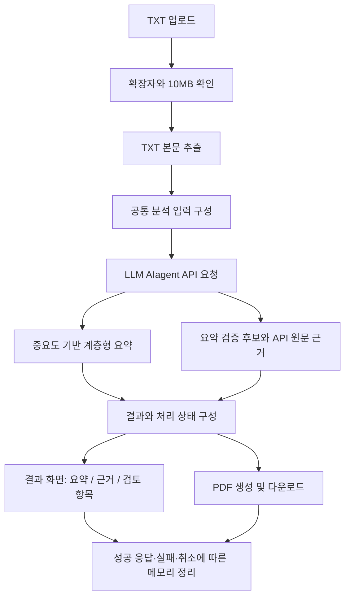

# MVP 설계서

## 1. 문서 정보 및 기준

| 항목 | 내용 |
| --- | --- |
| 프로젝트명 | sumnote-20261115 |
| 문서 목적 | 확정된 요구사항·기능분해를 연결하고, 남은 1시간에 구현할 최소 수직 기능과 단계별 확인 기준을 제안한다. |
| 기준 문서 | `docs/requirements.md`, `docs/function-breakdown.md` |
| 일정 | 요구사항 문서에는 총 3시간, 팀원 4명으로 기록되어 있다. 사용자의 최신 결정에 따라 현재 남은 시간은 1시간이다. |
| 현재 구현 상태 | 확인 가능한 Frontend·Backend 구현 파일이 없었다. 따라서 기존 실행 기반, API 연결 상태, 데이터 계약은 확인할 수 없다. |
| 문서 상태 | TXT 단일 형식 우선 제안은 1시간 대응 권고이며, 최종 구현 범위로 사용자 승인된 결정은 아니다. |

이 문서는 MVP 설계와 확인 계획만 정의한다. 구현 코드와 테스트는 추가하거나 실행하지 않았다.

## 2. MVP 목표와 기준

### 2.1 전체 요구사항 목표

지원 문서를 업로드하면 파일별 본문·표 데이터를 추출하고, LLM AIagent API를 이용해 중요도 기반 계층형 요약 및 사람이 확인할 검증 후보와 원문 근거를 제공한다. 결과 화면과 PDF 다운로드를 제공하며, 스프레드시트 입력은 XLSX 결과도 제공한다. DB와 임시 파일에는 원본·결과를 저장하지 않는다.

### 2.2 남은 1시간에 대한 축소 제안

요구된 6개 확장자와 추출, AI 요약·검증, 결과 화면, PDF/XLSX 생성을 모두 한 시간 안에 구현할 수 있다고 판단할 근거가 없다. 현재 저장소에서 실행 기반도 확인되지 않았다. 따라서 우선 **TXT 파일 하나로 업로드부터 PDF 다운로드까지 연결하는 수직 기능**을 구현하는 방안을 권고한다.

| 구분 | 1시간 구현 제안 | 전체 요구사항 대비 상태 |
| --- | --- | --- |
| 입력 | `.txt`만 허용, 최대 10MB, 확장자로 형식 확인 | PDF·DOCX·XLSX·XLS·CSV는 후속 범위 제안 |
| 추출 | TXT 본문을 메모리에서 추출해 공통 분석 입력으로 구성 | 인코딩 세부 기준은 구현 단계에서 결정 |
| AI 요약·검증 | LLM AIagent API 연동, 중요도 기반 계층형 요약, 검토 후보와 API 원문 근거 표시 | API 계약·중요도 단계는 구현 단계에서 결정 |
| 결과 표시 | 문서명, 요약, 핵심 내용, 주제·키워드·수치·조건, 원문 근거, 검토 후보·상태 제공 | 상세 UI 구성은 기존 요구사항 기준 적용을 권고 |
| 다운로드 | PDF 생성 및 다운로드 | 스프레드시트 전용 XLSX 출력은 이번 제안에서 제외 |
| 데이터 보관 | DB·임시 파일 미저장, 메모리 처리 | 기존 요구사항 유지 |

이 축소안은 기존의 전체 파일 지원 요구사항을 대체하지 않는다. 어떤 확장자를 남은 한 시간의 MVP로 삼을지는 사용자 결정이 필요하다. 한 시간 내 라이브 API 연결 및 결과 PDF 생성도 API 접근 권한·환경과 기존 프로젝트 구동 여부에 좌우된다.

### 2.3 이번 제안의 우선순위

1. 하나의 파일 형식에서 업로드, 입력 확인, 추출, API 요청, 요약·검증 결과, PDF 다운로드까지 연결한다.
2. 결과에는 요약과 근거를 구분하고 검증이 최종 사실 판정이 아닌 검토 후보임을 표시한다.
3. 실패 시 사용자에게 사유를 보여 주고 재시도 여부를 사용자가 결정하게 한다.
4. 복잡한 형식별 파싱과 XLSX 출력은 이 짧은 범위의 후속 작업으로 제안한다.

## 3. 기능 범위와 추적

| MVP 기능 | 설계 범위 | 기준 문서 ID |
| --- | --- | --- |
| 업로드·확장자 확인 | 제안 범위에서는 `.txt`만 받고 확장자로 형식을 확인 | R-01, IN-01, IN-02 |
| 크기 확인 | 모든 파일 최대 10MB | R-06, IN-03 |
| 본문 추출 | TXT에서 AI 분석용 본문을 메모리로 추출 | EXT-03, EXT-06 |
| 계층형 요약 | 중요도에 따라 제목·개요·핵심 내용을 정리하고 원문에 없는 내용을 추가하지 않음 | R-03, SUM-01~SUM-07 |
| 검증 후보 | 원문·요약 비교를 통해 누락·불일치·과장·수치 오류 등 검토 후보와 근거 제공. AI의 최종 판정으로 표현하지 않음 | R-04, VER-01~VER-06 |
| 결과 표시 | 문서 정보와 필수 요약 항목, 원문 근거, 검토 항목, 검증 상태를 구분해 표시. 빈 값은 `없음`으로 표시 | R-03, R-04, SUM-07, VER-05 |
| 결과 PDF | TXT 결과를 PDF로 다운로드. 원문 전체는 포함하지 않고 요약과 근거를 구분하며 중요도 순으로 배치 | R-01, OUT-01~OUT-03 |
| 실패·재시도 | 실패 사유를 안내하고 사용자가 재시도 여부를 결정 | R-01, R-06, IN-03 |
| 미저장·폐기 | DB와 임시 파일 미저장, 실패 시 메모리 자료 즉시 폐기 | R-05, IN-06, DT-01, DT-02 |

위 ID는 참조 문서에 존재하는 ID만 연결했다. 1시간 제안에서 미포함한 형식의 전체 요구사항도 유지된다.

### 3.1 전체 목표에는 포함되나 1시간 제안에서는 미루는 범위

- PDF 입력 및 텍스트 추출, 최대 20페이지 확인. OCR은 하지 않는다.
- DOCX 입력 및 본문 추출.
- XLSX·XLS 입력, 숨김 시트 제외, 표시 시트 최대 10개 확인.
- CSV 입력 및 단일 시트 처리.
- 스프레드시트 입력의 XLSX 결과 생성.
- 결과 화면의 전체 상태 표현과 긴 결과 탭·페이지 이동 세부 처리.

이 목록은 일정에 맞춘 범위 축소 제안이다. 위 항목의 요구사항 자체를 삭제하거나 영구 제외하지 않는다.

## 4. 핵심 기능 연결 과정

| 연결 단계 | 입력 | 출력 및 다음 연결 |
| --- | --- | --- |
| 업로드 확인 | 사용자 선택 파일 | 확장자·용량 판정 후 TXT 추출 또는 오류 안내 |
| TXT 추출 | 업로드 파일 | 본문 텍스트 및 문서 기본 정보 |
| 공통 입력 구성 | 추출 본문 | LLM AIagent API 요청에 사용할 내용. 구체 스키마는 구현 단계에서 결정 |
| AI 요약 | 원문과 API 결과 | 중요도 기반 요약 항목 및 근거 |
| AI 검증 | 원문, API 결과, 요약 | 사람이 확인할 검토 후보, 근거, 검증 상태 |
| 결과 제공 | 문서 정보, 요약, 근거, 검토 후보, 상태 | 화면 표시와 PDF 다운로드 |
| 자료 정리 | 처리 메모리 자료 | 실패 시 즉시 폐기. 성공은 다운로드 응답 완료 후, 취소는 취소 확인 즉시 폐기하는 기존 초안 기준 적용 |

## 5. 구현 순서와 단계별 확인 기준

아래 순서는 기능을 작은 단위로 구현하고 각 단위가 다음 단계로 넘어갈 수 있는지 확인하도록 구성했다. 확인 기준은 계획이며 실제 검증을 실행한 결과가 아니다. 시간은 팀 전체 경과 시간 기준의 제안이고, 현재 코드나 환경이 확인되지 않아 보장할 수 없다.

| 순서 | 제안 시간 | 작은 구현 단위 | 단계 완료 확인 기준 | 우선순위 |
| --- | ---: | --- | --- | --- |
| 0 | 0–5분 | 저장소 실행 및 API 접근 확인 | 기존 앱이 실행되고 필요한 LLM AIagent API 접근 설정이 있는지 확인한다. 미충족이면 라이브 수직 기능은 이 일정에 맞추기 어렵다고 즉시 공유한다. | 차단 조건 |
| 1 | 5–12분 | TXT 업로드와 입력 확인 | `.txt`는 접수되고 다른 확장자 및 10MB 초과 파일은 분석 전에 거부되며, 사용자에게 오류와 재시도 선택을 제공한다. | P0 |
| 2 | 12–18분 | TXT 추출·공통 입력 | 본문이 추출되어 다음 분석 단계로 전달되고, 빈 내용·읽기 실패가 성공 결과처럼 넘어가지 않는다. | P0 |
| 3 | 18–30분 | API 요약·검증 연결 | API 결과로 계층형 요약 및 검토 후보를 구성하고, 후보에 API가 반환한 근거를 연결한다. 오류·불충분 결과를 구분한다. | P0 |
| 4 | 30–40분 | 결과 데이터와 최소 화면 | 문서 정보, 요약, 원문 근거, 검토 후보, 상태가 분리되어 보이고 검증 미생성은 정상 완료와 구분된다. | P0 |
| 5 | 40–52분 | PDF 생성·다운로드 | 성공 결과에서 PDF가 내려받아지고, 원문 전체가 들어가지 않으며 요약·근거가 구분된다. | P0 |
| 6 | 52–60분 | 오류 흐름·자료 정리·통합 점검 | 제한 초과·API 실패·PDF 생성 실패가 안내되고 재시도는 사용자 선택을 따른다. DB·임시 파일 미저장 및 실패 시 메모리 자료 즉시 폐기를 확인한다. | P0 |

### 5.1 필요한 구현 역량과 팀 작업 배치 제안

요구사항·기능분해서에는 프레임워크나 팀원별 숙련도가 정해져 있지 않다. 아래 역량은 기능을 구현하는 데 필요한 작업 영역에서 도출했으며, 특정 기술 선택이나 팀원별 확정 배정이 아니다. 팀원 4명이 모두 투입 가능하다면 역할 분담은 다음처럼 제안한다.

| 역할 제안 | 작업 | 통합 지점 |
| --- | --- | --- |
| Frontend | TXT 업로드, 진행·오류 상태, 결과 표시, PDF 다운로드 조작 | 업로드·결과 API 계약 |
| Backend 입력·추출 | 확장자·용량 확인, 메모리 TXT 추출, 공통 입력 구성 | 파일 처리 계약 |
| Backend AI 연동 | LLM AIagent API 호출, 요약·검토 후보와 근거 연결 | AI 요청·응답 구조 |
| 통합·출력 | 결과 상태 연결, PDF 생성 응답, 오류·폐기 흐름 통합 확인 | Frontend와 Backend 간 데이터 계약 |

## 6. 전체 지원 형식의 순차 확장 계획

1시간 제안 범위가 완료되고 추가 시간이 승인되면 다음 순서로 확장한다. 각 형식은 업로드부터 결과 제공까지 작은 흐름으로 확인한다.

| 후속 순서 | 기능 단위 | 확인 기준 | 관련 ID |
| --- | --- | --- | --- |
| A | PDF 텍스트 추출 | 텍스트가 추출되고 실제 20페이지 초과는 거부된다. OCR을 하지 않는다. | IN-04, EXT-01, R-06 |
| B | DOCX 추출 | 본문이 공통 입력으로 전달되고 읽기 실패가 구분된다. 페이지 제한은 없다. | EXT-02, R-01 |
| C | XLSX·XLS 추출 | 표시 시트만 추출되고 숨김 시트가 제외되며 표시 시트 10개 한도를 확인한다. | IN-05, EXT-04, R-02, R-06 |
| D | CSV 추출 | CSV가 한 시트로 처리되고 헤더·행 데이터가 공통 입력에 전달된다. | EXT-05, R-02 |
| E | 스프레드시트 결과 | 전체 요약·시트별 요약 XLSX를 생성하고 PDF도 제공한다. | OUT-02, OUT-03, R-02 |
| F | 결과 화면 확장 | 완료·경고·실패·결과 없음, 검증 미생성 상태와 긴 결과 탐색을 요구사항대로 반영한다. | R-03, R-04, VER-05 |

## 7. 기준 문서에서 확정된 내용과 구현 중 정할 내용

| 항목 | 확정 내용 | 구현 단계 또는 사용자 확인이 필요한 내용 |
| --- | --- | --- |
| 입력 확장자 | TXT, DOCX, PDF, XLSX, XLS, CSV | 1시간 범위에서 어느 형식을 우선 구현할지 확정 필요. 이 문서는 TXT 우선안을 제안 |
| 업로드 기준 | 확장자로 형식 확인, 모든 파일 최대 10MB | 형식별 파서 세부 동작 |
| 페이지·시트 | PDF만 텍스트 추출 뒤 실제 20페이지 제한; TXT·DOCX·Excel·CSV는 용량만 확인; 숨김 시트 제외, 최대 10개 표시 시트, CSV 한 시트 | 실제 페이지 수를 얻는 구체 방식 등 구현 세부 |
| PDF 입력 | 텍스트만 추출, OCR 제외 | 텍스트 없는 스캔 PDF의 사용자 안내 세부 문구 |
| AI | LLM AIagent API 활용, 중요도 기반 계층형 요약, API 결과를 원문 근거 출처로 활용 | API 제공자/주소, 인증, 입력·응답 데이터 형식, 오류·시간 초과 처리 |
| 출력 | PDF 포함. 스프레드시트는 XLSX도 제공. 원문 전체는 PDF에 포함하지 않음 | PDF의 A4 서식은 초안, 실제 서식 디테일은 미정 |
| 결과 화면 | 필수 항목 표시, 빈 값 `없음`, 데스크톱 기준, 모바일 전용 구현 없음, 오류 시 사용자 재시도 결정 | 1시간 안에 탭·페이지 이동과 모든 상태 수용 기준까지 구현할지 범위 확인 필요 |
| 데이터 | DB·임시 파일에 저장하지 않음, 실패 시 즉시 폐기 | 성공은 다운로드 응답 완료 후, 취소는 취소 확인 즉시 폐기하는 기존 초안 기준 적용 |

## 8. 결정 및 재정의 요청

아래는 참조 문서에 확정되지 않았거나 일정 축소로 선택이 필요한 항목이다. 설계서에서는 확정값처럼 처리하지 않는다.

1. **한 시간 MVP의 입력 형식:** 권고안은 TXT 단일 형식이다. TXT 대신 PDF, DOCX 또는 Excel을 우선할지 결정이 필요하다.
2. **축소 범위 승인:** 선택한 형식 외 입력과 Excel XLSX 결과는 후속 범위로 미루는 안이다. 전체 요구사항은 유지하며, 이 일정 제안에 대한 범위 승인만 필요하다.
3. **API 실제 연동 준비:** LLM AIagent API를 사용하기로 확정되었지만 주소, 인증값, 호출 가능 여부와 입력·응답 형식은 구현 단계에서 결정하기로 했다. API 접근이 준비되지 않으면 한 시간 안의 실제 요약·검증 연결은 차단될 수 있다.
4. **검증 결과와 다운로드 경계:** 요구사항은 일부 근거 확인 필요, 검증 미생성, 실패·결과 없음에도 PDF 다운로드를 허용한다. 제안된 1시간 범위에서 이 모든 PDF 상태를 포함할지, 성공 결과 다운로드부터 완성할지 우선순위 재정의가 필요하다.
5. **요약 중요도 기준:** 중요도 기반 계층형 구성은 확정되었지만 계층 수와 중요도 판정 규칙은 구현 단계에서 정해야 한다.
6. **API 근거 구조:** 근거를 API 결과에서 사용하기로 했지만 원문 인용 범위, 위치 정보, 응답 필드는 API 계약 결정 시 정해야 한다.

## 9. 완료 판정

### 제안된 1시간 수직 기능의 완료 기준

- 선택한 입력 형식의 파일이 업로드부터 결과 화면까지 처리된다.
- 크기 제한 및 읽기·API 오류가 성공 상태와 구분되고, 사용자에게 재시도 여부를 묻는다.
- 계층형 요약과 검토 후보가 제공되며, 요약과 원문 근거가 구분된다.
- PDF를 내려받을 수 있고 원문 전체가 포함되지 않는다.
- DB·임시 파일에 원본이나 결과가 저장되지 않으며 실패 즉시 메모리 자료를 폐기한다.

이 완료 기준은 제안된 우선 형식에 대해서만 적용한다. 전체 제품 요구사항 완료로 간주하지 않는다.

### 전체 요구사항 완료 기준

전체 입력 6종의 제한 확인·추출, 중요도 계층형 요약·API 근거 기반 검토 후보, 결과 화면의 상태·탐색, 모든 입력에 대한 PDF와 스프레드시트 XLSX, 실패 안내·재시도, 자료 미저장·폐기 기준이 확인되어야 한다. 이 전체 범위는 남은 1시간 MVP 제안과 구분한다.
